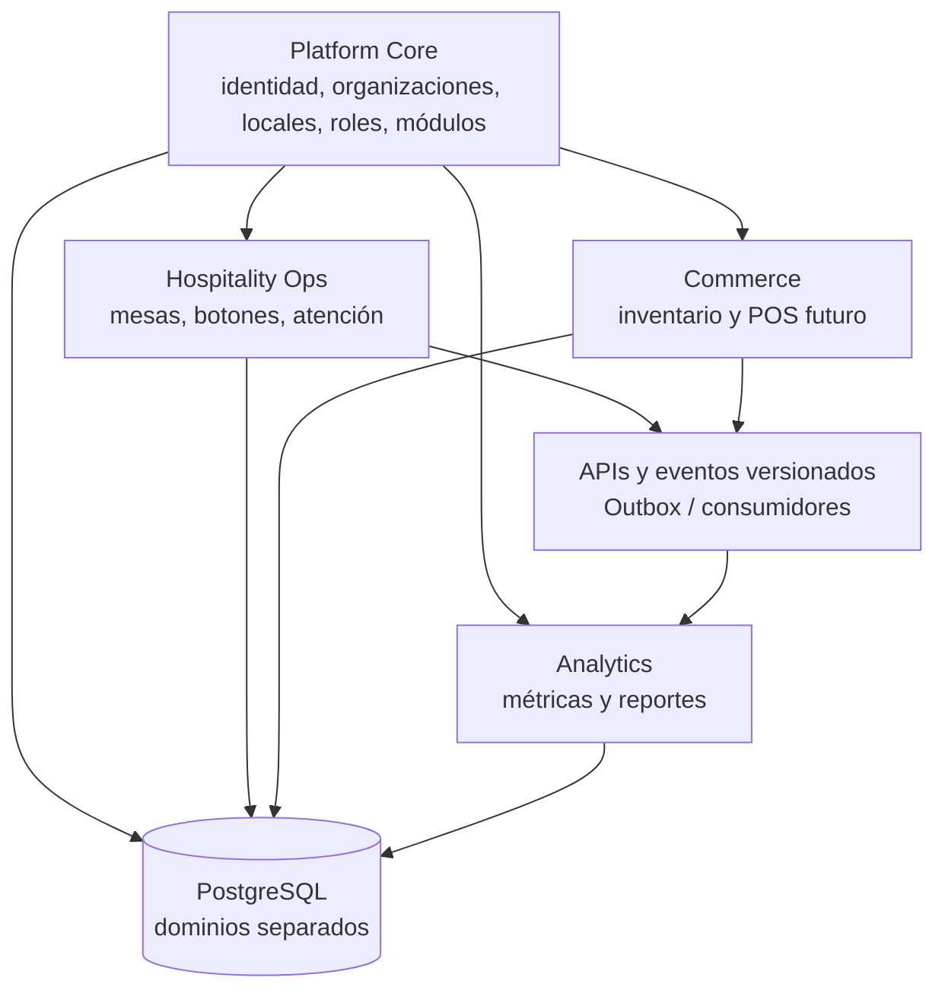
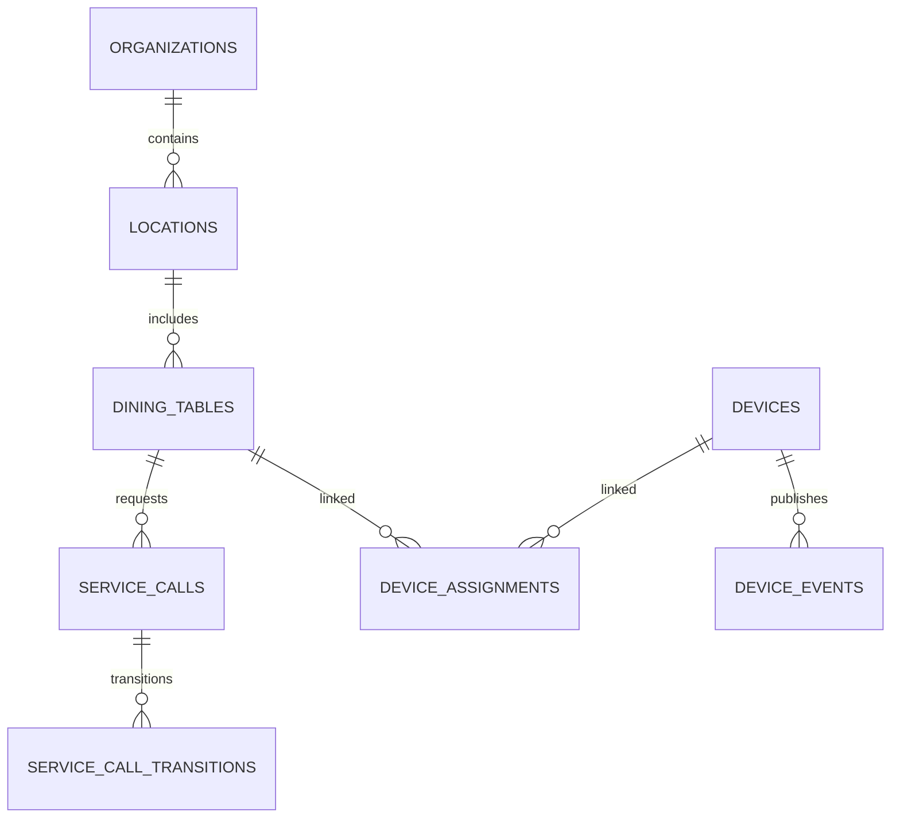

# ADR-001 — Arquitectura SaaS multiproducto y alcance del MVP

> **Proyecto:** Emprendimiento — plataforma SaaS modular  
> **Fecha de congelación:** 19 de octubre de 2026  
> **Estado:** Arquitectura objetivo acordada como referencia de diseño; implementación pendiente de especificación y validación.  
> **Tipo de decisión:** Arquitectura de productos, repositorios, integración y organización de PostgreSQL.  
> **Alcance:** Plataforma multiproducto (objetivo) y piloto inicial en un bar (MVP).

## 1. Resumen de la decisión

La empresa construirá una **plataforma SaaS multiproducto** en la que el portal gastronómico es un producto, no el centro de todos los módulos. Esto permitirá ofrecer inventario y métricas a otros comercios —por ejemplo, una tienda de zapatos— **sin darles acceso a mesas, botones o llamados de mesero**.

Se adopta como **arquitectura objetivo** una estructura de **cuatro repositorios** con límites de dominio y propiedad de datos:

| Repositorio | Producto/dominio | Responsabilidad principal |
|---|---|---|
| `platform-core` | Núcleo SaaS | Identidad, organizaciones, locales, membresías, permisos y habilitación de módulos/suscripciones |
| `hospitality-ops` | Operación gastronómica | Portal gastronómico, mesas, botones, solicitudes de atención y notificaciones en tiempo real |
| `commerce` | Comercio | Inventario, catálogo y, en una evolución futura, POS/ventas |
| `analytics` | Métricas | Indicadores, reportes, proyecciones y análisis, consumiendo datos/eventos autorizados de otros dominios |

**Actualización explícita del MVP:** a diferencia de la respuesta anterior, **el piloto inicial SÍ incluye métricas básicas e inventario básico**, además de portal gastronómico, mesas, botones y notificaciones. **POS completo NO pertenece al MVP**.

La separación por repositorios es el destino arquitectónico. La fecha de creación de cada repositorio y el número inicial de despliegues son decisiones de implementación que no se deben confundir con el alcance funcional obligatorio.

## 2. Objetivo de producto y ejemplo de independencia

### Caso A — Bar/restaurante

Puede contratar y acceder a:
- Operación gastronómica (mesas, botones, llamadas).
- Inventario básico o avanzado según su plan.
- Métricas de atención e inventario.
- POS solo cuando el módulo exista y esté habilitado.

### Caso B — Tienda de zapatos

Puede contratar y acceder a:
- Inventario (productos, tallas, colores, existencias).
- Métricas comerciales o de inventario.
- POS cuando esté disponible.

No tendrá pantallas, permisos ni entidades de mesas/botones. La autenticación y la administración comercial pertenecen al Core compartido, no a Hospitality.

### Caso C — Cafetería

Puede contratar combinaciones de Hospitality, Commerce y Analytics sin obligación de habilitar todo el ecosistema.

**Regla comercial:** la ubicación de dos funcionalidades en el mismo repositorio no obliga a venderlas juntas; los planes, derechos de uso (*entitlements*) y roles gobiernan el acceso.

## 3. Arquitectura lógica objetivo



La ilustración muestra **dependencias lógicas**, no acceso irrestricto a tablas. Cada dominio tiene sus propias reglas de negocio y su propio esquema/datos. Los módulos usan APIs y eventos; no escriben directamente datos pertenecientes a otro dominio.

### Interfaces web

- `platform-core`: administración de cuenta, usuarios, locales, roles y módulos contratados.
- `hospitality-ops`: portal para empleados y administradores gastronómicos.
- `commerce`: interfaz de inventario y, posteriormente, POS para negocios que lo contraten.
- `analytics`: consultas, indicadores y reportes autorizados.

La experiencia puede tener navegación común y SSO, **sin implementar microfrontends en el MVP**. Las aplicaciones pueden ser React independientes y reutilizar componentes/contratos compartidos mediante paquetes versionados.

## 4. Organización de los cuatro repositorios

```text
company/
├── platform-core/
│   ├── apps/api/
│   ├── apps/admin/
│   ├── packages/contracts/
│   └── database/
├── hospitality-ops/
│   ├── apps/api/
│   ├── apps/web/
│   ├── packages/contracts/
│   └── database/
├── commerce/
│   ├── apps/api/
│   ├── apps/web/
│   ├── modules/inventory/
│   ├── modules/pos/             # Futuro; no implementar en MVP
│   └── database/
└── analytics/
    ├── apps/api/
    ├── apps/web/
    ├── workers/                 # Futuro si se requiere procesamiento asíncrono
    └── database/
```

**Decisiones de integración del código:**
- Cada repositorio posee su CI/CD, migraciones y control de versiones.
- Los contratos HTTP/eventos se versionan; no se comparte directamente la capa interna Prisma de otro dominio.
- Un repositorio físico adicional para gateway/firmware (`hospitality-edge`) se abrirá únicamente cuando exista software local propio que lo justifique.
- No debe diseñarse un despliegue complejo de microservicios para cumplir artificialmente la separación de repositorios: puede haber servicios pequeños o módulos empaquetados de modo pragmático, respetando la propiedad de datos.

## 5. PostgreSQL: organización por dominios

### Decisión principal

En la etapa inicial puede utilizarse **una instancia administrada de PostgreSQL**, con **esquemas lógicos separados** y permisos delimitados por dominio. A futuro, los dominios pueden pasar a bases de datos independientes, sin dar acceso directo entre ellos.

| Esquema | Entidades de ejemplo | Dominio propietario |
|---|---|---|
| `core` | `organizations`, `locations`, `app_users`, `memberships`, `location_memberships`, `subscriptions`, `entitlements` | `platform-core` |
| `hospitality` | `dining_tables`, `devices`, `device_assignments`, `device_events`, `service_calls`, `service_call_transitions`, `outbox_events` | `hospitality-ops` |
| `commerce` | `products`, `product_variants`, `stock_locations`, `stock_movements`, `stock_balances`, `outbox_events`; en el futuro `sales`, `sale_items`, `payments` | `commerce` |
| `analytics` | En el MVP, consultas/proyecciones simples; a futuro `event_inbox`, `service_call_facts`, `stock_facts`, `daily_metrics` | `analytics` |

### Modelo de tenant genérico

```text
Organization (cliente SaaS)
└── Location (local físico genérico)
    ├── Hospitality (si está habilitado)
    ├── Commerce / Inventario (si está habilitado)
    └── Analytics (si está habilitado)
```

`Location` no presupone la existencia de mesas: puede ser bar, restaurante, cafetería o tienda. `Hospitality` es dueño de las mesas, botones y llamados; `Commerce` es dueño de los productos y existencias.

### Reglas de integridad y aislamiento

1. UUID como identificadores públicos estables, con `organization_id` y `location_id` en los registros operativos que correspondan.
2. Un usuario puede pertenecer a varias organizaciones/ubicaciones, sujeto a membresías y permisos.
3. Cada dominio es responsable de sus migraciones y tablas; **otros dominios no deben ejecutar escrituras ni consultas acopladas directamente a sus tablas**.
4. Las referencias entre dominios se realizan por ID y se verifican mediante contratos/API o eventos; al separar bases de datos, no se presuponen claves foráneas entre bases.
5. Para aislamiento multi-tenant se aplican validaciones de autorización en API; se considerará RLS de PostgreSQL como defensa adicional correctamente configurada.
6. Índices, restricciones únicas y controles de concurrencia deben garantizar invariantes críticos en la base, no solamente en el frontend.
7. Los timestamps se almacenan como `TIMESTAMPTZ`; las zonas horarias operativas se definen por local.
8. Evitar borrados físicos de registros con historial; utilizar desactivación y conservar trazabilidad.

### Relaciones operativas de Hospitality



Las asignaciones botón-mesa son históricas para soportar sustituciones de hardware. `service_calls` mantiene estado actual; `service_call_transitions` guarda cambios; `device_events` conserva eventos físicos.

**Invariante:** solo una solicitud activa por mesa (`pending` o `in_progress`). Implementar índice único parcial y lógica idempotente para pulsaciones duplicadas.

### Modelo básico de inventario en Commerce (MVP)

| Tabla | Uso durante el piloto |
|---|---|
| `products` | Catálogo de productos/insumos |
| `product_variants` | Opcional para variantes como tamaño/color; no forzar su uso en cada ítem |
| `stock_locations` | Ubicación donde se contabiliza stock; mínimo una por local |
| `stock_movements` | Entrada, salida y ajuste, con responsable, fecha y motivo |
| `stock_balances` | Saldo actual por producto/variante y ubicación, actualizado transaccionalmente |

Se sugiere que `stock_movements` sea el libro histórico, y que los saldos sean su proyección. El MVP no incluye recetas, compras complejas, comandas ni descuento automático por ventas del POS.

### Métricas básicas en Analytics (MVP)

- Número de llamados por mesa, local y período.
- Tiempo hasta reconocimiento y tiempo registrado hasta marcar la atención como finalizada.
- Solicitudes pendientes/en atención/atendidas y pulsaciones repetidas.
- Entradas, salidas, ajustes y existencias actuales de inventario.

Se pueden calcular con consultas agregadas y vistas/proyecciones sencillas, sin una infraestructura analítica separada. Si los datos de distintos dominios deben combinarse, usar APIs o eventos para construir lecturas propias; evitar consultas SQL cruzadas permanentes.

## 6. Comunicación entre productos

| Necesidad | Mecanismo propuesto |
|---|---|
| Autenticación | Identidad central / proveedor compatible con OIDC y validación de tokens |
| Permisos de productos | Entitlements de Core, verificados en el backend |
| Comandos y lecturas directas | APIs REST versionadas |
| Cambios de negocio | Eventos de dominio versionados |
| Fiabilidad de eventos | Transactional Outbox, reintentos, idempotencia |
| Tiempo real de solicitudes | Socket.IO dentro de Hospitality |
| Pulsación de botón | Adaptador IoT independiente del tipo de hardware; MQTT es candidato, no requisito irrevocable |

**Ejemplos de eventos:**

```text
hospitality.service_call.created.v1
hospitality.service_call.acknowledged.v1
hospitality.service_call.completed.v1
commerce.product.created.v1
commerce.stock.adjusted.v1
commerce.stock.received.v1
commerce.stock.issued.v1
commerce.sale.completed.v1   # Solo cuando exista POS
```

Analytics consume eventos autorizados y genera sus propias proyecciones. Una caída de Analytics no debe interrumpir llamadas de mesas ni operaciones de inventario. No se requiere Kafka, RabbitMQ, Redis ni Kubernetes para la primera versión por defecto; el transporte y los workers se introducen según necesidades reales de integración.

## 7. Stack de referencia

| Capa | Selección propuesta |
|---|---|
| Interfaces web | React + TypeScript + Vite |
| Backend | NestJS + TypeScript |
| Base de datos | PostgreSQL |
| ORM/migraciones | Prisma, con SQL explícito para restricciones avanzadas cuando convenga |
| APIs | REST versionada |
| Eventos | Contratos versionados + Outbox |
| Tiempo real | Socket.IO |
| IoT | Adaptador independiente de hardware, MQTT cuando aplique |
| Despliegue | Docker y servicios administrados, sin Kubernetes inicialmente |

Estas tecnologías son opciones de implementación inicial, sujetas a validación técnica; **los límites de dominio y la propiedad de datos son decisiones más estables que el proveedor de infraestructura**.

## 8. Alcance funcional congelado del MVP

El piloto en un bar debe demostrar el flujo principal de atención y ofrecer utilidades operativas complementarias sencillas:

| Funcionalidad | MVP | Detalle mínimo |
|---|---|---|
| Portal gastronómico | **Sí** | Autenticación, acceso por local y panel operativo |
| Gestión de mesas | **Sí** | Alta/edición/desactivación, identificación y relación con botón |
| Botones físicos | **Sí** | Identificación, asociación y recepción confiable de pulsaciones |
| Solicitudes y notificaciones | **Sí** | Pendiente → en atención → atendida; tiempo real e historial |
| Métricas básicas | **Sí** | Conteos y tiempos de atención; información básica de inventario |
| Inventario básico | **Sí** | Catálogo, entradas, salidas, ajustes y saldos |
| POS completo | **No** | Ventas, pagos, caja y facturación se posponen |
| Métricas avanzadas | **No** | BI, proyecciones complejas, análisis predictivo, etc. |
| Inventario avanzado | **No** | Recetas, compras, costos avanzados e integraciones automáticas |

### Cómo implementar el MVP sin sobredimensionarlo

- **Producto y repositorios objetivo:** cuatro (`platform-core`, `hospitality-ops`, `commerce`, `analytics`).
- **Trabajo inmediato:** priorizar Core y Hospitality, pero **Commerce e Analytics sí tienen entregables básicos obligatorios** en el piloto. No dejarlos fuera del alcance por ser repositorios futuros.
- **Separación práctica:** construir inventario como dominio `commerce` y métricas como dominio `analytics`, aunque inicialmente cada uno use una implementación mínima; no acoplar permanentemente esas reglas al código de Hospitality.
- **Despliegues iniciales:** por definir al elaborar el plan de implementación; evitar infraestructura distribuida innecesaria. Separar repositorios no implica automáticamente cuatro microservicios en producción.
- **Desarrollo secuencial recomendado:** autenticación/tenants → mesas/solicitudes → tiempo real/botones → inventario básico → métricas básicas → pruebas del piloto. En paralelo pueden prepararse los esquemas y contratos de los cuatro dominios.

## 9. Fuera de alcance y decisiones abiertas

**Fuera del MVP:** POS completo; facturación electrónica; pagos; recetas; cadena de abastecimiento compleja; analítica avanzada; automatizaciones sofisticadas y despliegues con alta disponibilidad compleja.

**Pendiente de definición técnica:**
1. Cuándo inicializar exactamente los cuatro repositorios y cómo empaquetar/desplegar servicios durante el piloto.
2. Qué proveedor de autenticación e infraestructura usar.
3. Modelo detallado de permisos, planes y entitlements.
4. Contratos API y eventos entre Core, Hospitality, Commerce y Analytics.
5. Esquema SQL completo y migraciones por dominio.
6. Tecnología y configuración final de los botones/gateway, investigada por separado.
7. Reglas de operación desconectada y sincronización al volver internet.
8. Si variantes de producto se requieren desde el primer piloto o quedan como capacidad de expansión.

## 10. Decisiones congeladas / criterio de cambio

- **Arquitectura objetivo: cuatro repositorios por dominio de producto.**
- **Core SaaS independiente del sector gastronómico.**
- **Hospitality no controla inventario, POS ni Analytics.**
- **Commerce agrupa inventario y POS futuro, con módulos contratables por separado.**
- **Analytics es reutilizable por cualquier sector y no debe bloquear los módulos operativos.**
- **PostgreSQL con separación por dominios, propiedad de tablas y aislamiento por tenant.**
- **Integración mediante APIs y eventos versionados.**
- **MVP del bar: portal gastronómico + mesas + botones + notificaciones + métricas básicas + inventario básico.**
- **No construir el POS completo ni los módulos avanzados antes de validar el piloto.**

Toda modificación importante a estas decisiones debería registrarse en un nuevo ADR, sin sobrescribir este documento histórico.
